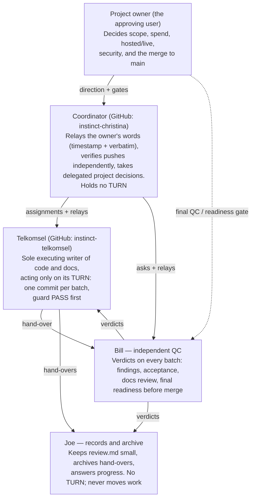

# Team

Five roles run this project. The chart shows who decides, who builds, who checks, and who keeps the record. Every block links to the written rules it follows.

## The roles

1. **Project owner (approving user)** — decision authority over scope, spend, hosted and live access, security, and the merge to main. Direction reaches the team through the Coordinator's relays. The merge runs once, as the last action, under the owner's original conditional grant — after Bill's final readiness green and every role done; it needs no new approval at merge time. Rules: [review-protocol.md](review-protocol.md), [DECISIONS.md](DECISIONS.md)
2. **Coordinator** (GitHub: instinct-christina) — relays the owner's words with timestamp and verbatim quote, verifies every builder push independently, and takes the routine prototype decisions the owner delegated (D1–D7, ratified id rules). Holds no TURN. Scope changes, spend, hosted/live and security stay with the owner; merge runs only under the owner's original once-only conditional grant, its conditions unchanged. Rules: [review-protocol.md](review-protocol.md), [review.md](review.md)
3. **Telkomsel** (GitHub: instinct-telkomsel) — sole executing writer of code and docs, acting only on its TURN: one commit per batch, guard check passing before each push, then hands the batch to Bill. Rules: [review-protocol.md](review-protocol.md), [review.md](review.md), [HANDOFF-BLUEPRINT.md](HANDOFF-BLUEPRINT.md)
4. **Bill** — independent QC. Verdicts on every batch: findings, acceptance, docs review, and the final readiness call before merge. Stays independent of the builder. Rules: [review-protocol.md](review-protocol.md), [review.md](review.md), [review-verified.md](review-verified.md)
5. **Joe** — records and archive. Keeps review.md small, archives hand-overs in [review-archive.md](review-archive.md), answers progress. Holds no TURN and never moves work. Rules: [review-protocol.md](review-protocol.md), [review-archive.md](review-archive.md)

## How to read the arrows

- The project owner block is decision authority. Bill holds the final QC / readiness gate. The merge to main runs once, as the last action, under the owner's original conditional grant, its conditions unchanged - coordinated after Bill's readiness green and every original condition and prerequisite (blueprint sections, this chart) is fulfilled.
- The Telkomsel–Bill loop is the QC cycle: every batch hands over for a verdict, and verdicts shape the next batch.
- Joe receives records from both and holds no authority to move work.
- Every batch moves only when review.md line 1 names its TURN. The owner alone opens scope, spend, hosted access and security.

## Still open

- The hosted Supabase run has not been done; it is documented as pending any applicable prerequisite.
- Bill's quality control is green on the current code; the final readiness verdict is due on the final head.
- Merge to main stays parked until every role is done and that verdict is green.
